# Kiến trúc lab

## Hiện trạng

```mermaid
flowchart LR
  Dev[Máy học viên] -->|SSH ED25519, đã xác minh| VPS[VPS Linux]
  VPS --> Host[Linux: systemd, kernel, filesystem, network]
  Host -. Phase 1 sau khi đạt preflight .-> Docker[Docker/containerd labs]
  Docker -. Phase 2 sau khi gate đạt .-> K8s[kubeadm single-node]
  K8s -. Backup, clean transition .-> RKE2[RKE2 single-node]
  RKE2 -. Conditional, đủ tài nguyên .-> Rancher[Rancher lab]
```

## Thiết kế theo phase

1. VPS một node dùng để học Linux, network và container runtime; không giả định địa chỉ IPv4 public. Kiểm tra IPv6, private IPv4, NAT, DNS và firewall trước khi mở dịch vụ.
2. Docker/containerd được học trước Kubernetes. Chạy ASP.NET Core API như workload minh họa.
3. kubeadm và RKE2 dùng các phase riêng. Sao lưu dữ liệu, ghi lại trạng thái, sau đó cleanup theo runbook trước khi chuyển runtime/cluster.
4. Rancher chỉ triển khai sau đánh giá tài nguyên và backup; nếu VPS không đáp ứng thì hoãn tới môi trường local tháng 2.
5. Multi-node, HA, GPU, Longhorn, Harbor, GitLab server và quan sát đầy đủ cần nhiều node/tài nguyên; hiện để Deferred Labs.

## Network boundary

SSH là đường quản trị. SSH key authentication đã được xác minh; cấu hình `sshd` hiện vẫn bật password authentication và root login. Client báo dùng Cloudflare WARP, còn phiên server ghi nhận peer IPv6; source egress chưa xác minh độ ổn định. Provider firewall chưa xác minh và UFW đang inactive. Kubernetes API, etcd, kubelet và service ports không được mở công khai mặc định. Không thay đổi firewall từ xa nếu chưa có console/out-of-band rollback, rollback timer và SSH session thứ hai.
