# Kiến trúc lab

## Luồng học và deployment

```mermaid
flowchart LR
  PC[Windows local: OpenSSH + PowerShell] -->|key-only SSH; scripts trong mktemp| VPS[VPS Linux single node]
  VPS --> LNX[Linux Labs 01–06]
  LNX -->|network/security/resource gates| Docker[Docker]
  Docker --> Containerd[containerd / OCI / CRI]
  Containerd --> Kubeadm[kubeadm single-node main lab]
  Kubeadm -->|backup, cleanup, re-assess| RKE2[RKE2 conditional]
  RKE2 -->|resource gate; local if insufficient| Rancher[Rancher deferred decision]
```

## Runtime boundaries

1. VPS một node dùng trước cho Linux, network và container runtime exercises; không giả định có public IPv4. Kiểm tra IPv6, private IPv4, NAT, DNS và firewall trước khi mở public service.
2. Windows OpenSSH key-only proof không đồng nghĩa server password authentication đã tắt. SSH hardening plan tách riêng và chưa áp dụng.
3. Linux safe labs không phụ thuộc public-service gate; các bài này không mở port hay sửa firewall/SSH/network.
4. Docker API sample đầu tiên bind localhost và được truy cập qua SSH tunnel. Review host/provider ingress và Docker firewall behavior trước khi publish port.
5. kubeadm và RKE2 có phase riêng. Trước khi chuyển runtime: snapshot/backup, kiểm chứng backup, cleanup và resource gate. Rancher/monitoring stack chạy local nếu VPS không đủ budget.
6. Kubernetes API, etcd, kubelet, NodePort và RKE2 registration ports không mở Internet mặc định.

## Repository responsibilities

- `README.md`: entry point, quick start và liên kết.
- `docs/progress.md`: single source of truth cho phase status/evidence.
- `docs/infrastructure.md`: sanitized facts đã quan sát qua SSH, tách unknowns.
- `docs/resource-budget.md`: resource thresholds/gates và host limits.
- `scripts/preflight.sh` / `scripts/security-baseline.sh`: inventory, không tự khẳng định phase PASS.
- `scripts/validate.sh`: required/optional gates theo repository hoặc phase.
- `scripts/run-remote.ps1`: upload scripts vào temp directory qua SSH, kiểm tra cú pháp và cleanup.
