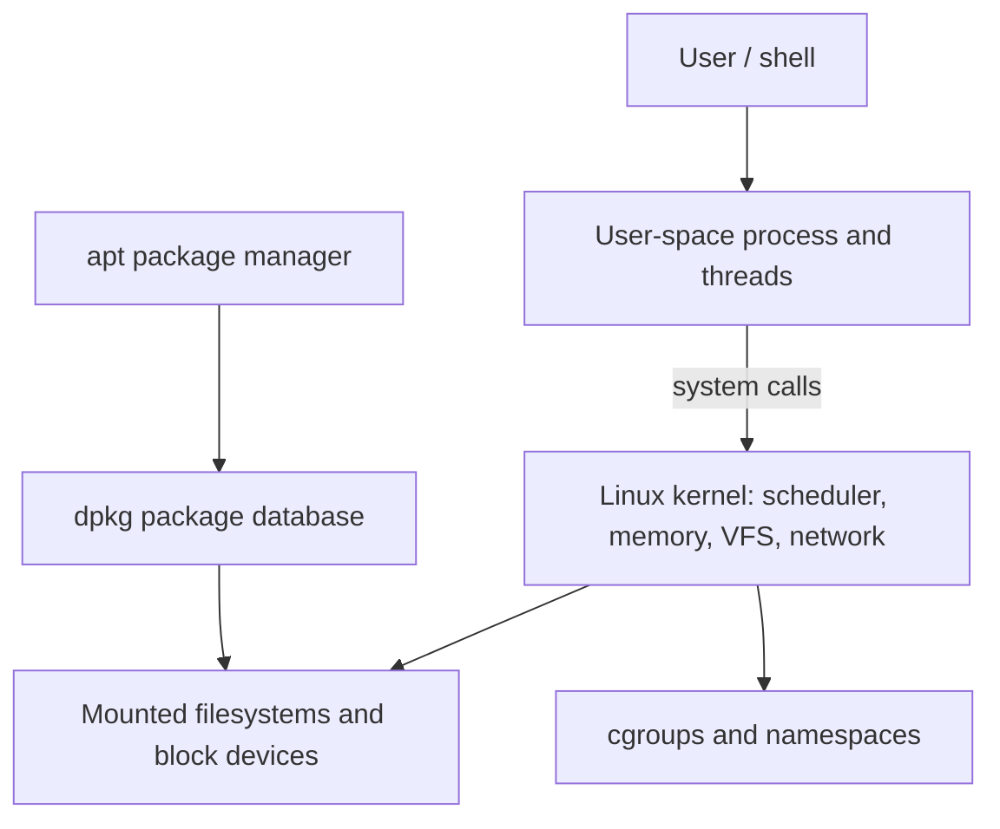

# Lab 01 — Linux Fundamentals

Lab này chuyển từ inventory Phase 0 sang các khái niệm Linux cơ bản: filesystem, kernel/user space, CPU architecture, process/thread, account, permissions/ACL, environment, shell và package management.

## 1. Mục tiêu

- Phân biệt file, filesystem, mount và các nhánh chính trong Linux filesystem hierarchy.
- Giải thích kernel cung cấp system calls cho user-space processes như thế nào.
- Đọc CPU architecture và phân biệt process với thread.
- Đọc UID/GID, group membership, ownership, mode bits, `umask` và ACL metadata.
- Giải thích shell/environment và quan hệ giữa `apt` và `dpkg`.
- Thực hành permission changes chỉ trên một file tạm trong `/tmp`.

## 2. Cơ chế cần nắm



- **Filesystem hierarchy:** `/` là gốc của một cây tên thống nhất. `/etc` chứa cấu hình host; `/usr` phần lớn chứa chương trình/thư viện; `/var` chứa state/log thay đổi; `/home` dành cho user thường; `/root` là home của root; `/tmp` là vùng file tạm; `/proc` và `/sys` là filesystem ảo cung cấp kernel/process state; `/dev` đại diện thiết bị; `/run` chứa runtime state. Đường dẫn không nhất thiết là một filesystem riêng: xem `findmnt`.
- **Kernel và user space:** shell, `apt`, `sshd` là processes user space. Chúng yêu cầu kernel qua system calls để mở file, tạo process/thread, cấp phát memory và gửi packet. `uname` cho biết kernel đang chạy; `/etc/os-release` cho biết distro userspace.
- **CPU architecture:** `uname -m` báo architecture kernel; `getconf LONG_BIT` báo userland word size. `x86_64`/`amd64` là 64-bit x86. vCPU là CPU time được hypervisor cấp; `lscpu` không chứng minh workload có hiệu năng tương đương CPU vật lý.
- **Process/thread:** process có PID và resource context; thread có TID, scheduler state riêng và thường chia sẻ address space trong cùng process. `ps -e` đếm process rows; `ps -eLf` hiển thị thread rows. Hai con số thay đổi liên tục.
- **Users/groups:** UID/GID là numeric identity được kernel kiểm tra; tên từ `/etc/passwd`/group database là cách đọc thuận tiện. Root có UID 0. Group membership thêm quyền qua group mode bits hoặc ACL.
- **Permissions:** ba nhóm owner/group/other với `rwx`. Trên directory, `x` nghĩa là traverse/search. `/tmp` thường mode `1777`: sticky bit ngăn user xóa file của user khác dù directory world-writable.
- **ACL:** POSIX ACL bổ sung quyền cho user/group cụ thể ngoài ba nhóm mode bits. `getfacl` đọc và `setfacl` sửa ACL. Chưa có utility ACL trên VPS nên phần này được đánh dấu NOT TESTED.
- **`umask`:** loại bỏ bit khỏi mode mặc định; thường file bắt đầu từ `666`, directory từ `777`. Với `umask 077`, file mới là `600`, directory mới là `700`.
- **Environment/shell:** mỗi process nhận environment riêng từ parent. Không chạy `env`/`printenv` toàn bộ trên máy thật vì có thể chứa token. Script chỉ in `SHELL`, `LANG`, `TERM`, UID và số thành phần `PATH`.
- **Package management:** `apt` giải dependency và làm việc với repository; `dpkg` cài/ghi package database trên máy. `apt-cache policy` chỉ đọc candidate cache; `apt update/install/upgrade` là thay đổi hệ thống và không nằm trong bài này.

## 3. Điều kiện và phạm vi

- Ubuntu VPS đang hoạt động; SSH key login đã xác minh.
- Không cần `sudo` cho user root hiện tại.
- Không cập nhật/cài package, sửa SSH/firewall/sysctl, mount disk hoặc bật swap.
- Demo permission chỉ tạo một file trong thư mục tên `/tmp/devops-lab01.*`; script có `trap` để xóa file và directory.

## 4. Chạy lab

Từ PowerShell trong repository:

```powershell
scp .\scripts\lab01-readonly.sh devops-lab:/tmp/lab01-readonly.sh
ssh -o BatchMode=yes -o PreferredAuthentications=publickey -o PasswordAuthentication=no -o KbdInteractiveAuthentication=no devops-lab "bash /tmp/lab01-readonly.sh --permissions-demo"
```

Bỏ `--permissions-demo` nếu chỉ muốn inventory read-only. Script chỉ in một số environment key được cho phép, không in IP/hostname, không đọc nội dung `/etc/shadow`, không cài package.

Các lệnh tương đương để tự khám phá:

```bash
uname -r; uname -m; getconf LONG_BIT; lscpu
findmnt -T /; df -hT /
ps -e --no-headers | wc -l; ps -eLf --no-headers | wc -l
id; getent passwd "$(id -un)"; getent group sudo
stat -c '%n %U:%G %a' / /etc/passwd /etc/shadow /tmp
getfacl /etc/passwd   # nếu utility đã có; không cài chỉ để chạy bài này
umask
apt-get --version; dpkg --print-architecture; apt-cache policy bash
```

`stat` trên `/etc/shadow` chỉ đọc metadata; không `cat` file này. Không dump toàn bộ environment hay process command line.

## 5. Kết quả runtime đã quan sát

Trạng thái ghi nhận ngày 2026-11-20; process/memory/disk counts là snapshot:

| Nội dung | Output quan sát | Đánh giá |
|---|---|---|
| Root filesystem | ext4, khoảng 38 GB, 2.3 GB used, 36 GB available lúc đo | PASS cho lab Linux nhỏ; xem `docs/resource-budget.md` trước runtime nặng |
| Kernel/architecture | kernel `6.8.0-142-generic`, `x86_64`, `LONG_BIT=64` | PASS; distro userspace Ubuntu 24.04.5 |
| CPU | 4 CPU rows, 1 thread/core, 4 cores, 1 socket; `lscpu` báo VT-x | 4 vCPU hiện có; flag virtualization không chứng minh nested VM đã cấu hình |
| Process/thread | 143 process rows, 178 thread rows tại lúc đo | Minh họa số lượng; thay đổi theo thời gian |
| Account | `root`, UID/GID 0; shell `/bin/bash`; group `sudo` tồn tại | PASS; không liệt kê account khác |
| Permissions | `/etc/passwd` 644; `/etc/shadow` 640 root:shadow; `/tmp` 1777 | Metadata đọc được bằng root |
| Environment/shell | `SHELL=/bin/bash`, `LANG=C.UTF-8`, Bash 5.2.21 | PASS; environment chỉ được allowlist |
| Package tools | dpkg arch `amd64`, apt 2.8.4; Bash package 5.2.21-2ubuntu4 | Chỉ đọc package database/cache; không update/install |
| Permission demo | `umask 077` → mode `600`; `chmod 640` → mode `640` | PASS; temp file được dọn khi script thoát |
| ACL | `getfacl`/`setfacl` không có sẵn | NOT TESTED; không cài package |

Không commit process list, user list đầy đủ, IP, hostname, raw preflight hay machine identifiers.

## 6. Troubleshooting

| Triệu chứng | Nguyên nhân/kiểm tra |
|---|---|
| `getfacl: command not found` | ACL utility không cài. Ghi NOT TESTED; không cần cài package để hoàn thành các phần còn lại. |
| `Permission denied` với `/etc/shadow` | User không có quyền đọc metadata; không tăng quyền rộng. Chạy `stat` qua quyền quản trị chỉ khi được phép. |
| `ps` counts khác lần trước | Process/thread counts là snapshot và thay đổi bình thường. |
| File demo còn sót trong `/tmp` sau SSH bị ngắt | Kiểm tra chính xác thư mục `/tmp/devops-lab01.*` vừa tạo; chỉ xóa đúng file `sample.txt` và directory đã xác minh là của bài này. |
| `apt-cache` báo thiếu candidate | Cache/package sources chưa có metadata mới; không tự chạy `apt update` trong lab read-only. |

## 7. Security, backup và rollback

Inventory không đổi system state. Demo tạo đúng một file test và gọi `chmod` trên file đó; trap dọn file/directory. Không có dữ liệu cần backup. Nếu SSH bị ngắt giữa demo, kiểm tra đường dẫn `/tmp/devops-lab01.*` trước khi dọn thủ công.

Không lưu credentials hay output chứa hostname/IP vào Git. Nếu credential từng xuất hiện trong ảnh/chat, không dùng lại và thu hồi/đổi theo quy trình của provider. Cấu hình `sshd` cho phép password/root login là WARNING riêng trong [security runbook](../../docs/runbooks/phase-0-preflight.md).

## 8. Câu hỏi và đáp án ngắn

1. **Kernel và distro khác nhau thế nào?** Kernel quản lý hardware/resource/syscalls; distro ghép kernel với userspace, package manager và policy.
2. **Process và thread khác nhau thế nào?** Process là resource/security context chính; thread là execution flow được scheduler chạy trong process và thường chia sẻ address space.
3. **Vì sao `/tmp` mode `1777`?** Mọi user có thể tạo file; sticky bit giới hạn xóa/đổi tên file theo owner/root.
4. **Mode `640` nghĩa là gì?** Owner đọc/ghi, group đọc, others không có quyền.
5. **ACL thêm gì ngoài mode bits?** Quyền cho named user/group; mask giới hạn quyền hiệu lực của named users/groups và group class.
6. **Vì sao không gửi `env` output?** Child processes có thể nhận token/password trong environment; allowlist tối thiểu làm giảm rủi ro lộ.
7. **`apt` và `dpkg` khác nhau thế nào?** `apt` giải dependency/repository; `dpkg` thao tác package cục bộ và database.

## 9. Bài tập/checklist

- [ ] Chạy `lab01-readonly.sh` và đọc từng section.
- [ ] Tự giải thích vì sao `/proc` và `/sys` khác `/etc`.
- [ ] Tính quyền file mặc định khi `umask 027` là `640`, directory là `750`.
- [ ] So sánh mode bits với ACL; đánh dấu ACL là NOT TESTED trên VPS này.
- [ ] Nêu vì sao `lscpu` báo VT-x không đồng nghĩa VPS có nested virtualization sẵn sàng.
- [ ] Không cài package hay đổi quyền file hệ thống trong bài này.
