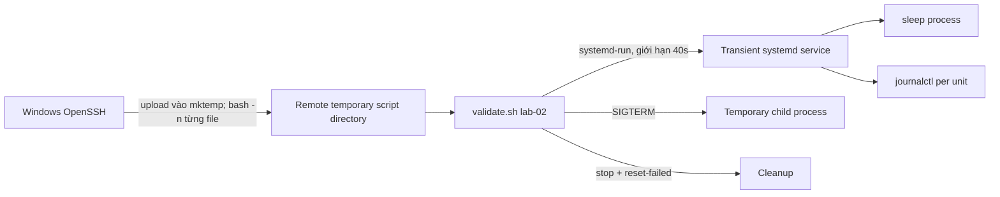

# Lab 02 — systemd, services, processes, signals và journalctl

## Mục tiêu

- Đọc trạng thái systemd manager, failed units và journal usage.
- Tạo, quan sát và dừng một transient systemd service mà không cài package hay ghi unit file cố định.
- Theo dõi MainPID/cgroup metrics, đọc log của đúng unit.
- Gửi `SIGTERM` cho một process con và giải thích `wait` status.
- Xác minh cleanup sau bài thực hành.

## Lý thuyết và kiến trúc

`systemd` quản lý service units và trạng thái tiến trình; `systemd-run` tạo transient unit trong runtime manager. `systemctl show` quan sát ActiveState, PID và cgroup properties; `journalctl -u` lọc log theo unit. `SIGTERM` yêu cầu process kết thúc có kiểm soát. Trong Bash, `wait` cho process bị SIGTERM thường trả 128 + số signal, tức 143 cho SIGTERM 15.



## Điều kiện và phạm vi

- Chạy trên Ubuntu VPS qua SSH alias đã được xác minh; bài transient system service cần quyền quản trị system manager.
- Không cài package, sửa cấu hình, tạo unit file lâu dài, mở port hay gây tải CPU/RAM/disk.
- Service chỉ chạy `/usr/bin/sleep 35`, có `RuntimeMaxSec=40s`; cleanup dừng unit và process.
- Một dòng marker do bài lab ghi vào journal có thể còn lại sau cleanup. Không xóa journal hệ thống để dọn bài tập.

## Chạy bài lab

Từ PowerShell tại repository root:

```powershell
.\scripts\run-remote.ps1 -Phase lab-02
```

Helper tạo remote directory bằng `mktemp`, upload đúng hai script cần thiết, chạy riêng `bash -n` cho mỗi file, gọi `validate.sh lab-02`, rồi chỉ xóa các file `.sh` và directory do lần chạy đó tạo.

Lệnh trực tiếp khi các script đã ở trong cùng repo Linux:

```bash
./scripts/validate.sh lab-02
```

## Expected output và kiểm chứng

Kết quả thành công phải có các marker sau; phiên bản systemd, PID, process count và số đo cgroup thay đổi theo thời điểm:

```text
PASS: transient service accepted by the systemd manager.
PASS: transient service reached ActiveState=active (...).
PASS: journalctl contains the exercise start marker.
PASS: systemctl stop returned success and ActiveState=inactive.
PASS: SIGTERM delivered; Bash wait status was 143.
PASS: temporary child process and transient service cleanup completed.
LAB 02 STATUS=PASS; bounded systemd, journal, process and signal checks completed.
Validation summary: FAIL=0 UNKNOWN=0 WARNING=0
```

Các bằng chứng cần lưu dạng đã làm sạch trong phần runtime results bên dưới: systemd manager state, cgroup/MemoryCurrent/CPUUsageNSec của transient service, process `sleep`, marker trong journal, ActiveState sau stop và `wait` status 143. Không lưu raw journal hay process list vào Git.

## Runtime results

- Thời điểm: 2026-11-20, chạy qua Windows OpenSSH alias với helper `run-remote.ps1`.
- **PASS:** systemd 255 (255.4-1ubuntu8.19), manager `running`, 0 failed units; journal usage 8.0 MB; process count snapshot 143.
- **PASS:** transient service đạt `ActiveState=active`, MainPID được quan sát; `ControlGroup=/system.slice/...`, `MemoryCurrent=266240` bytes (~260 KiB), `CPUUsageNSec=9058000` (~9.1 ms) tại lúc đo.
- **PASS:** process `sleep` quan sát bằng `ps`; marker `DEVOPS_LAB02_SERVICE_STARTED` xuất hiện trong journal; stop trả thành công và service thành `inactive`.
- **PASS:** child nhận SIGTERM, Bash `wait` trả 143; transient unit/process và remote temporary script directory đã cleanup.
- Host services, SSH, firewall, package và network không bị thay đổi. Marker journal nhỏ là dấu vết duy nhất được giữ có chủ đích.

Lần kiểm tra đầu phát hiện CRLF trong một dòng script khi chạy trên Ubuntu và SCP không giữ executable mode; helper được sửa để chuẩn hóa file LF và đặt mode 0700 trong remote temp directory. Lần chạy runtime kế tiếp phát hiện race giữa `kill` và `exec`, cùng transient unit có thể tự unload sau stop; script giờ chờ xác nhận process `sleep` và cleanup kiểm tra `LoadState`. Kết quả PASS ở trên lấy từ lần chạy sau các sửa đổi.

## Troubleshooting

| Triệu chứng | Điều tra | Cách xử lý/verification |
|---|---|---|
| `systemd-run` báo không thể kết nối system manager | Kiểm tra `id -u`, `systemctl is-system-running`, SSH đang vào đúng host và quyền system manager | Chạy từ SSH alias root đã xác minh; nếu system manager lỗi thì dừng lab, không restart host services. |
| Service không đạt `ActiveState=active` | Xem `systemctl show <unit> -p LoadState -p ActiveState -p SubState -p Result` và `journalctl -u <unit> --no-pager` | Script tự dừng unit khi lỗi. Chỉ điều tra unit có prefix `devops-lab02-` vừa tạo; không kill process/units khác. |
| Journal marker chưa xuất hiện | Xác minh chính xác unit name, mốc `--since` và `journalctl -u <unit>` | Không coi journal output rỗng là PASS; validator báo FAIL. Không bật persistent logging hay cài package cho bài này. |
| `wait` không trả 143 | Process có thể tự thoát trước khi signal hoặc shell/command khác cấu thành process | Đọc status đã in; PASS chỉ khi child còn sống lúc nhận SIGTERM và `wait` trả 143. |
| Remote helper không cleanup được | Đọc đúng đường dẫn `mktemp` helper in ra và chỉ kiểm tra directory do lần chạy này tạo | Không dùng `rm -rf /tmp/devops-lab-*`; nếu cần cleanup, xóa đúng `.sh` trong đúng directory rồi `rmdir` directory rỗng. |

## Resource, security, backup và rollback

- Giới hạn một transient service với một lệnh `sleep`; không có workload benchmark, OOM test hoặc disk write test.
- Tất cả file upload nằm dưới thư mục unique `mktemp` mode 0700; không truyền credentials trong script hoặc argv.
- Không có persistent config/state cần backup. Cleanup tự động dừng process/service, chạy `systemctl reset-failed` và xóa script tạm. Nếu cleanup báo lỗi, giữ lại unit name trong terminal để kiểm tra chính xác.
- Journal marker là dấu vết quan sát có chủ đích; không xóa toàn bộ journal của host.

## Câu hỏi phỏng vấn

1. `systemctl is-active` khác `systemctl is-enabled` thế nào?
2. Transient unit khác unit file trong `/etc/systemd/system` thế nào?
3. `MainPID`, `ControlGroup`, `MemoryCurrent` và `CPUUsageNSec` giúp điều tra gì?
4. Khi nào `SIGTERM` phù hợp hơn `SIGKILL`? Khi nào process không thể xử lý SIGTERM?
5. Vì sao một `wait` status 143 thường biểu thị termination bởi SIGTERM?
6. `journalctl -u` giới hạn phạm vi điều tra thế nào so với đọc journal toàn host?

## Checklist

- [ ] `bash -n` chạy riêng trên từng Bash script được upload.
- [ ] Transient service đạt active, log marker xuất hiện và cgroup metrics được đọc.
- [ ] `systemctl stop` xác nhận service inactive.
- [ ] Child process nhận SIGTERM và `wait` trả 143.
- [ ] Helper dọn đúng remote temporary directory; không xóa journal hay host state.
- [ ] `docs/progress.md` chỉ ghi runtime PASS sau output thực tế.
