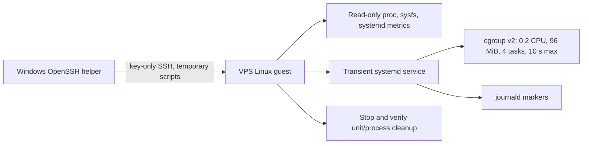

# Lab 03 — Linux performance, memory, I/O và cgroups

## Mục tiêu

Đọc đúng các chỉ số Linux trước khi phân bổ tài nguyên: CPU utilization và load average, scheduler/process states, RAM khả dụng và page cache, swap/OOM, disk I/O, file descriptors, cgroups v2 và PSI. Cuối bài chạy một transient systemd service bị giới hạn CPU/RAM/task và tự cleanup. Bài lab không stress toàn VPS, không cấp phát gần cạn RAM và không ghi dữ liệu lên disk.

## Theory

### CPU, load và scheduler

- `lscpu` hiển thị CPU logic mà guest nhìn thấy. Guest reporting 4 logical CPUs nghĩa là 4 vCPU được cấp; không suy ra được số physical cores của host hoặc mức oversubscription của provider.
- `/proc/stat` chứa cumulative CPU ticks. Hai snapshot cách nhau một giây cho phép tính tỷ lệ delta. `user` gồm user-mode work, `system` là kernel work, `iowait` là thời gian CPU idle khi có I/O chờ, `steal` là thời gian hypervisor lấy CPU khỏi guest. `top` và `vmstat` là snapshot/rate-oriented views.
- Load average đếm runnable tasks và tasks chờ uninterruptible I/O theo cửa sổ 1/5/15 phút; nó không phải CPU percentage. So load với số vCPU và cùng lúc xem `%idle`, `%iowait`, `%steal` để phân biệt CPU contention, storage wait và host contention.
- Linux scheduler chọn runnable task trên các logical CPUs. Context switches chuyển CPU giữa tasks; involuntary switches thường tăng khi cạnh tranh CPU/quota, voluntary switches thường xuất hiện khi task chờ I/O, lock hoặc timer. Lab đọc các thống kê kernel hiện có nhưng không tạo benchmark.
- Process state phổ biến: `R` runnable/running, `S` interruptible sleep, `D` uninterruptible sleep (thường I/O wait), `T` stopped/traced, `Z` zombie. `ps` state string có thể có modifiers; script đếm state letter đầu.

### RAM, virtual memory, swap và OOM

- `MemTotal` là RAM kernel-managed; `MemFree` chỉ RAM chưa dùng. Linux dùng RAM rảnh làm page cache/buffers nên `MemAvailable` là ước lượng phù hợp hơn cho workload mới mà không cần swap.
- `Cached`, `Buffers`, `SReclaimable`, `Shmem`, `Dirty` và `Writeback` giải thích một phần memory accounting. Page cache có thể được thu hồi; shared memory và pinned/anonymous working set không tương đương cache có thể reclaim ngay.
- Virtual memory cung cấp address spaces và demand paging. `Committed_AS` là tổng memory đã được hứa cho mappings; `CommitLimit` là giới hạn theo overcommit policy/swap, không phải RSS hiện dùng.
- Swap có thể giúp hấp thụ một số anonymous pages nhưng không thay thế RAM và không đáp ứng Kubernetes no-swap precondition. Khi cgroup/host không còn cấp phát được, OOM Killer có thể chọn process; `memory.events` đếm `oom`/`oom_kill` tại cgroup và journal/kernel log có thể ghi dấu vết. Không chủ động tạo OOM trong lab.

### Storage, descriptors và cgroup v2

- `df` đo filesystem capacity và inode; `du` duyệt directory entries để cộng file usage. Chúng trả lời câu hỏi khác nhau, chịu ảnh hưởng mount boundaries và deleted-open files.
- `/proc/diskstats` là cumulative per-block-device counters. IOPS là completed operations per second; throughput là bytes per second; mean completion latency xấp xỉ total completion milliseconds chia số operations. Một mẫu 1 giây ít I/O có thể cho zero operations; điều đó có nghĩa latency `NOT TESTED`, không phải latency zero. Device layers có thể cộng dồn hoặc che lấp underlying storage behavior.
- `ulimit -n` là soft limit của shell/process; `/proc/sys/fs/file-nr` là global kernel file-handle accounting. Process có thể hết descriptors dù host còn RAM/disk.
- cgroups v2 đặt giới hạn theo hierarchy. `cpu.max` dạng `quota period` với microseconds: `20000 100000` là tối đa 20 ms CPU mỗi 100 ms wall period, tức 0.2 CPU. `memory.max=100663296` là 96 MiB. `cpu.stat` thể hiện throttling; `memory.current`, `memory.events`, `pids.current/max` cho thấy usage và limit.
- PSI tại `/proc/pressure/{cpu,memory,io}` đo tỷ lệ/thời gian tasks bị stall do thiếu tài nguyên. `some` nghĩa ít nhất một task stall; `full` nghĩa mọi non-idle task bị stall cùng lúc. `avg10/60/300` là moving averages; `total` là cumulative microseconds. Một snapshot thấp không loại trừ burst pressure.

## Architecture



## Resource budget and preconditions

- Guest capacity theo VPS package: 4 vCPU, khoảng 3.8 GiB usable RAM, 40 GB SSD. Bắt đầu bằng `MemAvailable`, load, PSI và disk snapshot ngay trên host.
- Workload chỉ chạy nếu `MemAvailable >= 1 GiB`, load average 1 phút `< 2.0`, cgroup v2 khả dụng và transient systemd service được hỗ trợ.
- Giới hạn workload: `CPUQuota=20%`, `MemoryMax=96M`, `TasksMax=4`, `RuntimeMaxSec=10s`; Python tạo và touch 24 MiB, chạy CPU loop trong 2 giây, rồi sleep để đọc counters. Không dùng `stress`, không install package, không tạo file trên disk.
- Nếu resource gate fail, workload bị skip với exit 2; diagnostics vẫn có thể đã được in. Đợi thời điểm yên hơn rồi chạy lại. Không nới gate để ép PASS.

## Commands

Từ PowerShell ở Windows tại repository root:

```powershell
.\scripts\run-remote.ps1 -Phase lab-03
```

Helper upload đúng source scripts vào remote `mktemp`, xác minh `bash -n`, thực thi validator và cleanup thư mục tạm. Không thay đổi SSH/firewall/network/disk config. Source script: [`scripts/lab03-performance.sh`](../../scripts/lab03-performance.sh).

Đọc các nguồn metric độc lập (read-only):

```bash
uptime
top -b -n 1 | head -n 5
ps -eo stat= | sort | uniq -c
free -h
vmstat 1 2
cat /proc/stat
grep -E '^(MemTotal|MemFree|MemAvailable|Buffers|Cached|SwapTotal|SwapFree):' /proc/meminfo
df -hT /
cat /proc/diskstats
ulimit -n
cat /sys/fs/cgroup/cgroup.controllers
cat /sys/fs/cgroup/cpu.max /sys/fs/cgroup/memory.max
cat /proc/pressure/cpu /proc/pressure/memory /proc/pressure/io
systemctl show --property=DefaultCPUAccounting --property=DefaultMemoryAccounting --property=DefaultTasksAccounting
```

Các lệnh này đọc live state, không thay thế helper output và không tạo workload. `/proc/stat`, `/proc/diskstats` là cumulative counters; cần hai snapshot có thời gian để tính rate.

## Hands-on exercises

1. So sánh 1/5/15-minute load với `CPU(s)` của guest. Dùng `vmstat` `r`, `b`, `us`, `sy`, `wa`, `st` để giải thích state trong sample.
2. So `MemFree` và `MemAvailable`. Chỉ ra phần page cache/buffers có thể reclaim và xác nhận `SwapTotal` hiện tại; không bật swap.
3. Từ hai `diskstats` snapshots, tính IOPS/throughput và mean completion latency. Nếu không có operation trong mẫu, ghi `NOT TESTED`.
4. Xem file descriptor soft limit của shell và global file table. Nêu vì sao hai giá trị không thể thay thế nhau.
5. Quan sát transient unit `cpu.max`, `memory.max`, `cpu.stat`, `memory.events`, PSI và journald marker. Đối chiếu cấu hình systemd với cgroup v2 output.
6. Xác minh service `inactive`/`failed`, PID không còn, rồi remote helper tự xóa toàn bộ upload directory.

## Kubernetes connection

- `requests.cpu`/`requests.memory` là scheduling/accounting requests cho node capacity; chúng không tự tạo hard CPU cap hoặc memory cap. `limits.cpu` thành quota/throttling tương ứng; `limits.memory` là hard cgroup memory ceiling.
- Container `requests == limits` cho cả CPU và memory có thể đạt `Guaranteed` QoS nếu tất cả containers/init containers đáp ứng rule; các cấu hình khác thường là `Burstable`, không khai báo requests/limits thường là `BestEffort`. QoS ảnh hưởng eviction ordering dưới node pressure; nó không bảo đảm process không bị kill.
- Vượt memory cgroup limit có thể làm kernel OOM-kill process trong container; Kubernetes thường hiển thị `OOMKilled` trong container last state sau khi kubelet quan sát exit. Không phải mọi OOM event đều giống node-wide OOM.
- CPU quota throttling làm container bị ngừng chạy đến quota period kế tiếp; `kubectl top` CPU thấp có thể đi cùng latency cao do throttling. Theo dõi cgroup `cpu.stat`/throttled time cùng application latency.
- Node allocatable trừ system/kube reservations và eviction thresholds; request total cần giữ headroom cho OS/runtime. VPS usable 3.8 GiB không có nghĩa toàn bộ 3.8 GiB sẵn cho pods.

## Actual runtime results

Điền sau khi Lab 03 đã chạy qua SSH helper. Ghi thời điểm UTC, chỉ các tổng số đã làm sạch; không commit IP, hostname, process command lines, raw journal, output environment hay raw preflight files.

| Check | Kết quả đã quan sát | Ý nghĩa/giới hạn |
|---|---|---|
| `MemAvailable`, 1-minute load | Final run: `3,495,916 kB`; load `0.00/0.00/0.00`; gate PASS | Ngưỡng trước workload là 1 GiB và load `< 2`. |
| CPU `%user/%system/%idle/%iowait/%steal` | `0.0/0.2/99.8/0.0/0.0%` trong một giây | Sample ngắn; không đại diện host/provider lâu dài. `vmstat` sample cho thấy không có blocked task. |
| Memory, swap, disk/inodes | Total `4,009,132 kB`; no swap; root fs `6%`, inode `3%` | `MemFree` khoảng 2.1 GiB; page cache/buffers khoảng 1.5 GiB; dùng `MemAvailable` để xét headroom. |
| Disk I/O | Sample khoảng một giây không có completed read/write | IOPS/throughput bằng 0 cho sample; latency `NOT TESTED`, không kết luận storage nhanh/chậm. |
| PSI | Final run: CPU/memory/IO avg10/60/300 `0`; `full` `0` | Cumulative totals không đồng nghĩa áp lực hiện tại; snapshot không loại trừ burst. |
| cgroup v2 CPU/memory/tasks | `cpu.max=20000 100000`; `memory.current=29396992`, `memory.max=100663296`; `pids.current=1`, `pids.max=4`; `nr_throttled=25`; peak RSS `35072 KiB` | CPU quota 0.2 CPU được kernel throttle; 24 MiB allocation stayed under 96 MiB hard cap. RSS includes resident shared mappings, while cgroup current reports charged pages. Root cgroup không expose `cpu.max`/`memory.max`; transient service cgroup có. |
| Unit/process/temp upload cleanup | Unit inactive, process absent, transient cgroup removed, remote upload temp removed | Cleanup PASS; không còn workload hoặc cấu hình dai dẳng. |
| OOM log history | `NOT TESTED`; kernel journal filter returned exit 1 | Không có bằng chứng đủ để kết luận không có OOM trong journal retention; không tạo OOM thử nghiệm. |

## Troubleshooting

| Symptom | Cause to investigate | Safe next step |
|---|---|---|
| Resource preflight exit 2 | Available RAM below 1 GiB, load >= 2, or missing counter | Read current `free`, `uptime`, PSI; wait for headroom, do not force exercise. |
| `systemd-run`/cgroup properties unavailable | systemd manager or cgroup v2 controller/config does not support requested property | Keep diagnostics read-only, inspect `systemctl show` and cgroup mount; do not modify host configuration in this lab. |
| `nr_throttled=0` | Short CPU sample ended before quota enforcement or scheduler timing did not exercise quota | Record as failed verification; rerun only if resource gate is still met; don't increase duration/quota. |
| `memory.current` near/over max or OOM event changes | Different service behavior, stale unit, or unexpected host pressure | Cleanup/stop exact generated unit immediately, verify memory events and process state; do not retry until investigated. |
| Disk sample has zero reads/writes | Idle device during one-second interval | Record latency `NOT TESTED`; use counters over another quiet one-second observation, no synthetic I/O. |
| Remote cleanup failure | SSH unavailable or exact temporary path not removable | Inspect only the printed unique `/tmp/devops-lab.*` path over SSH; do not delete broad `/tmp` patterns. |

### Findings trong lần triển khai script

- Lần chạy đầu dừng an toàn trước workload vì kiểm tra `cpu.max`/`memory.max` ở cgroup root, nơi host không expose hai file này dù `cpu` và `memory` controllers có mặt. Gate được sửa sang đọc controller list; effective limits được kiểm tra trong cgroup của transient service.
- Một lần syntax/runtime probe phát hiện `load` và `system` là reserved built-ins trong gawk nên metric awk lỗi và resource gate bị hiểu nhầm là không đạt. Đổi tên biến thành `one_minute` và `sys_ticks`; lần chạy live cuối ghi metrics thật và workload PASS.
- Kernel OOM journal query trả exit 1; kết quả được ghi `NOT TESTED`, không được đổi thành PASS/zero incidents.

## Verification and cleanup

Required verification:

- Local/GitHub checks: Bash syntax, ShellCheck, PowerShell parser and SSH/SCP/helper mocks.
- Live VPS: diagnostics completed; cgroup values match `20000 100000` and `100663296`; CPU throttling was observed; service journal markers were read; service reached stopped state and PID disappeared.
- Cleanup: lab script verifies service inactive/failed and process absent; PowerShell helper verifies remote upload directory removal. Cleanup failure is FAIL, not warning.

The transient systemd unit is the only VPS workload. The lab stops it before success and has an EXIT trap plus `RuntimeMaxSec=10s` as fallback. There is no persistent config or data to rollback. Never use `systemctl reset-failed` or delete broad unit/file patterns as cleanup.

## Interview questions and answers

1. **Is load average CPU utilization?** No. It tracks runnable and uninterruptible tasks over 1/5/15-minute windows. Compare with vCPU count and CPU/IO counters.
2. **Why does `free` show little free RAM without memory pressure?** Linux uses otherwise-idle RAM for reclaimable page cache. `MemAvailable` estimates memory for new workloads more usefully.
3. **Does a CPU request cap a Kubernetes container?** No. CPU limits create quota/throttling; request supports scheduling and resource accounting.
4. **Why can a container be slow with low observed CPU?** It may be throttled by quota, waiting on I/O/locks, or constrained by another resource. Check `cpu.stat`, PSI, and application latency.
5. **What does `OOMKilled` establish?** Kubernetes observed a container termination associated with OOM; inspect last termination reason, cgroup memory events and node memory pressure to find scope/cause.
6. **Can `MemFree` be used for capacity planning?** Not alone. Account for reclaimable cache and use `MemAvailable`, pressure and workload working set.
7. **What is the difference between IOPS and throughput?** IOPS counts completed operations per time; throughput counts bytes per time. Latency is completion time and should be measured alongside both.
8. **Why is `/proc/diskstats` latency only an approximation?** Counters are aggregate cumulative device statistics, a short sample may be sparse, and stacked devices can double count or obscure the physical layer.

## Lab result

Update this section and [`docs/progress.md`](../../docs/progress.md) only after live output has been observed. Report local/static success, VPS runtime proof and production readiness as separate states.
