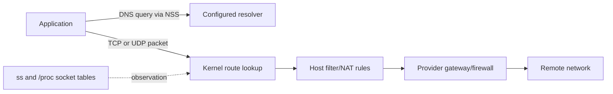

# Lab 04 — Networking: IPv4/IPv6, routes, DNS, TCP/UDP

## Theory

- IP addressing assigns a host address and prefix length. CIDR prefix length defines the network portion; route lookup uses longest-prefix match before metric/priority choices. IPv4 and IPv6 maintain separate route/address families.
- A default route handles destinations without a more-specific route. `ip route get` predicts a selected path without sending a packet. Next hop, egress interface and source selection explain the route; NAT may further translate source/destination at a gateway.
- DNS resolves names through the configured stub/resolver chain. `getent` follows the system Name Service Switch (NSS), which can include `/etc/hosts`, local resolver, and other configured sources. A successful lookup is not proof of public authority, inbound connectivity or DNSSEC.
- TCP is connection-oriented and has connection states; UDP is message-oriented and does not establish a session handshake. Listening sockets in `ss` do not prove they are reachable through host/provider firewalls.
- NAT and firewall are distinct: NAT changes packet addresses/ports; filtering allows, rejects or drops packets. UFW, nftables/iptables and a cloud/provider firewall can each affect a packet path. Docker can install its own forwarding/NAT rules; do not infer public safety from UFW alone.
- IPv6 Neighbor Discovery and ICMPv6 are operational dependencies. IPv4 NAT does not imply that IPv6 is protected by the same provider rule.

## Architecture



The lab observes the host route table, address families, resolver configuration, and local sockets. It performs one bounded NSS lookup for `example.org`, but it does not probe public inbound ports or alter network state.

## Commands

From Windows PowerShell in the repository root:

```powershell
.\scripts\run-remote.ps1 -Phase lab-04
```

Equivalent read-only Linux commands:

```bash
ip -o link show
ip -o address show
ip -4 route show table main
ip -6 route show table main
getent ahosts example.org
ss -s
ss -lntu
cat /proc/net/route /proc/net/ipv6_route
cat /proc/net/tcp /proc/net/udp
```

The source script redacts full addresses, route prefixes, next hops, DNS resolver addresses, and firewall match conditions. It prints prefix lengths, interface/family/scope, route counts and socket port/bind classes. Source: [`scripts/lab04-networking.sh`](../../scripts/lab04-networking.sh).

## Hands-on exercises

1. Identify which interfaces have IPv4, IPv6, loopback and link-local addresses; use prefix length to reason about subnet size without publishing exact host addresses.
2. Compare IPv4 and IPv6 default-route counts. Explain why an IPv4 NAT service does not prove IPv6 ingress is filtered.
3. Compare `getent` with `dig`: NSS may resolve `/etc/hosts` or another source before DNS. Treat `getent` success as system-name-resolution evidence only.
4. Identify TCP/UDP listening ports and bind classes. Explain why `LISTEN` plus wildcard bind still does not prove provider firewall reachability.
5. Trace a conceptual packet path through route lookup, host filtering/NAT and provider firewall. Do not change those layers in this exercise.

## Actual runtime results

Fill after running the helper. Store only sanitized summaries; no IPs, exact CIDRs, hostnames, DNS server values or raw firewall rules.

| Check | Result | Limit |
|---|---|---|
| IPv4/IPv6 interface and default-route summary | 2026-11-20: both address families and their route summaries were inspected | `scope global` is a Linux address-scope label, not proof that an address is Internet-routable. Exact interface/address/route values are kept local-only. |
| System resolver lookup | One configured resolver entry; `example.org` returned 4 unique address records; `systemd-resolved` active | DNS/NSS success does not establish authoritative or external reachability. |
| TCP/UDP listener summary | `ss` and kernel socket tables were inspected; exact ports and bind addresses are kept local-only | Local socket state only; not a firewall test. |
| Firewall summary | Host/provider posture remains a separate security gate; exact live values are kept local-only | No firewall changes; local inventory is not an external ingress test. |

## Troubleshooting

| Symptom | Cause to investigate | Safe next step |
|---|---|---|
| DNS lookup fails/times out | NSS order, resolver status, route or upstream DNS | Inspect sanitized `resolvectl status`, `/etc/resolv.conf`, `getent hosts`, and route summary; do not change resolver config. |
| No IPv4 or IPv6 default route | Provider-specific routing, disabled family, or deliberate isolated network | Record `NOT TESTED` for that path; do not add routes or disable IPv6. |
| Listener is wildcard-bound | Service accepts connections on all local addresses | Review service owner and provider ingress before any public exposure; this lab opens no port. |
| TCP succeeds locally but remote access fails | Host/provider filtering, NAT, bind address, or client path | Separate local socket proof from remote-path proof; inspect one layer at a time. |

## Interview questions and answers

1. **Does `getent` prove DNS works?** It proves the NSS lookup returned a result; `/etc/hosts` or a cache may have answered without contacting an authoritative DNS server.
2. **How is a route selected?** Linux evaluates the routing policy database and tables, then generally chooses the most-specific matching prefix and applies route metrics/attributes.
3. **What does a default route mean?** It is the fallback path when no more-specific route matches; IPv4 and IPv6 have independent tables.
4. **Does `ss -lnt` prove a port is public?** No. It shows a local socket; bind address, host rules, provider firewall, routing, and client path all matter.
5. **Why is UDP different from TCP?** UDP does not establish a transport connection or guarantee delivery/order; applications must supply any needed reliability.
6. **Why can Docker publishing bypass UFW?** Docker may install forwarding/NAT rules outside UFW's normal INPUT chain; review Docker's firewall backend and DOCKER-USER path before publishing.

## Verification and cleanup

The helper requires each remote script to pass `bash -n`, records exit status, and removes its exact unique upload directory. The lab itself only reads kernel/network state and makes one DNS/NSS lookup; there is no persistent state to clean or rollback. Do not count this as a port scan or external ingress verification.
