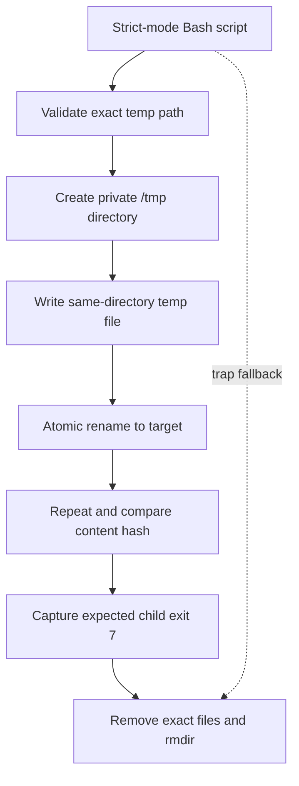

# Lab 06 — Bash automation: safety, quoting, idempotency and cleanup

## Theory

- `set -euo pipefail` asks Bash to stop on many unhandled failures, unset variables and pipeline failures. It does not replace deliberate status handling; commands inside conditions and expected non-zero operations need explicit treatment.
- Quoting `"$var"` preserves one argument even when it contains spaces, wildcard characters or shell syntax. Avoid `eval`: it turns data into code and can execute unintended commands.
- Exit statuses are part of a script's API: `0` success, non-zero failure. Capture `$?` immediately after an expected failure and restore strict mode deliberately.
- Idempotent automation can be repeated without changing the intended result. Write new content to a same-filesystem temporary file and atomically rename it into place to avoid a partially written target.
- `umask` applies a default permission mask at creation. A private working directory with mode `0700` and files with mode `0600` reduce accidental exposure.
- `trap` provides cleanup on ordinary exit/signals, but cannot recover from power loss or `SIGKILL`. Cleanup should target a unique path created by the script, verify it, and avoid broad wildcard deletion.

## Architecture



## Commands

From Windows PowerShell in the repository root:

```powershell
.\scripts\run-remote.ps1 -Phase lab-06
```

Local syntax-only check:

```bash
bash -n scripts/lab06-bash-automation.sh
shellcheck scripts/lab06-bash-automation.sh
```

The script creates only one unpredictable directory under `/tmp`, writes fixed non-secret sample text, verifies two repeat writes, captures a child status, and removes exact entries. Source: [`scripts/lab06-bash-automation.sh`](../../scripts/lab06-bash-automation.sh).

## Hands-on exercises

1. Replace the sample message with text containing spaces, `*`, `$HOME` and quotes. Confirm it remains literal data and is never evaluated.
2. Change `bash -c 'exit 7'` to another non-zero status; make the script report the actual code without causing `set -e` to skip cleanup.
3. Run the script twice. Each run gets its own temp directory; within a run the second atomic write preserves the first content hash.
4. Temporarily force a validation failure in a disposable local copy and confirm the EXIT trap removes only the matching temp directory.
5. Explain why same-directory rename is atomic on one filesystem and why that is not the same as durable storage (`fsync`).

## Actual runtime results

Fill after the remote run. Do not commit the unpredictable temporary path.

| Check | Result | Limit |
|---|---|---|
| Directory/file modes | Mode `700` directory and `600` state file | Mode applies only to the temporary sample. |
| Idempotent hash and quoted argument | Two writes had the same SHA-256; literal `*` and `$HOME` round-tripped in an argument with spaces | Fixed synthetic data only; no `eval`. |
| Expected exit status | Child `bash -c 'exit 7'` returned and was handled as `7` | Does not validate application error handling beyond this sample. |
| Cleanup | Exact `/tmp` directory and generated files removed; helper upload directory also removed | Cleanup PASS; unpredictable temp path not committed. |

## Troubleshooting

| Symptom | Cause to investigate | Safe next step |
|---|---|---|
| Unbound variable under strict mode | Variable not initialized or misspelled | Initialize expected optional values with `${value:-}`; keep required values strict. |
| Wildcards expand unexpectedly | Unquoted variable used as an argument | Quote expansions; inspect arguments with `printf '%q'`; do not add `eval`. |
| A non-zero child terminates the whole script | Expected failure was run under `set -e` without guarded status capture | Use an `if` condition or temporarily disable errexit for that one command and restore it immediately. |
| Cleanup refuses its path | Path did not match the unique prefix/format | Stop; inspect only the exact path. Do not broaden the cleanup pattern. |

## Interview questions and answers

1. **What does `pipefail` change?** A pipeline returns a non-zero status if any command fails, rather than only reflecting the last command.
2. **Why is quoting important?** It preserves the intended argument boundary and prevents word splitting and pathname expansion.
3. **What is idempotency?** Repeating an operation produces the same intended state without accumulating unintended side effects.
4. **Why write to a temporary file then rename?** Readers see either the old complete file or the new complete file, not a partially written target, when rename stays on the same filesystem.
5. **Does `trap EXIT` guarantee cleanup in every failure?** No. `SIGKILL`, kernel crash and power loss bypass it; use exact scoping and external recovery for persistent resources.
6. **Is a non-zero exit always a bug?** No. It is the failure signal of a command; automation must distinguish expected conditions from unexpected errors explicitly.

## Verification and cleanup

`bash -n` and ShellCheck validate syntax/style; the remote execution verifies modes, content hash, quote preservation, exit code and exact cleanup. The script runs no privileged command and modifies no persistent config. The trap is the fallback; explicit cleanup must pass before the script reports Lab 06 success.
